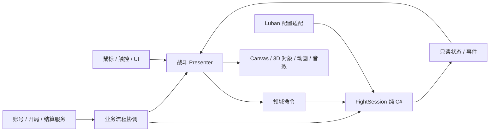

# 业务架构与服务器交互

## 分层和接入位置

| 层 | 拥有的内容 | 不应负责 |
| --- | --- | --- |
| Domain | 战斗规则、实体 ID、tick、PRNG、命中与死亡、金币、选卡与胜败 | Unity 对象、输入读取、网络请求、音效、资源路径加载 |
| Application | 主界面到开局到结算的顺序、账号会话、当前战斗、取消令牌、恢复策略 | 把 UI 按钮直接当作业务权威；在每帧发送账号请求 |
| Presentation | 鼠标/触控、对象池、插值、特效、相机、UI Presenter | 改实体血量或金币、决定卡牌抽取、通过动画事件偷偷结算伤害 |
| Infrastructure | Luban 适配、YooAsset、网络协议、持久化、时钟接口 | 依赖具体窗口实例、把整个战斗写成 SDK Manager |

`HotGame.StartGameAsync` 在 Luban 表加载完成后直接初始化并调用具体业务，退出时显式关闭；不再使用模块启动回调或额外 Session 注册器。AOT `GameEntry` 提供场景配置并启动 `GameHotUpdate`，后者处理代码与资源准备，玩法留在热更业务中。一次战斗由一个明确的 owner 创建、驱动和 Dispose；应用退出时先结束业务和取消任务，再走现有集中 Manager Release。

当前领域入口为 `FightSession(FightConfiguration, uint seed)`；命令为 `StartNextWave`、`BuildTower(slotId,towerTypeId)`、`UpgradeTower(instanceId)`、`ChooseCard(index)` 和 `SetPaused`，返回值表明是否被当前规则接受。`Step(ticks)` 推进模拟，`Phase/Gold/BaseHp/WaveIndex`、塔/怪状态和候选卡供表现读取。配置加载层负责把 `cfg.Tables` 转成领域配置，领域不直接依赖生成表类型。

表现层使用帧时间累积固定 tick，并限制单帧最多补多少 tick，防止卡顿后补算造成长时间卡死。暂停、选卡、进入后台和退出时明确停止推进。图像、塔模型和伤害飘字可以插值或异步播放，不能改变已经结算的领域结果。若以后引入物理弹道或弹道延迟，需要明确增加领域系统与事件，而不是修改表现对象的 `OnTriggerEnter` 即视为完成规则。

## 是否需要 PureMVC

首版不引入 PureMVC，也不新增一层对其命令、通知和代理的通用封装。现有框架已有资源管理、Page/Popup 导航、事件系统和清理机制；再套全局 Facade/Proxy/Notification 会增加状态归属和订阅生命周期，无法直接解决战斗规则、后端权威或内容制作。

先使用具体业务对象：应用 owner、`FightSession`、战斗 Presenter、页面 Presenter、账号/战斗服务接口。窗口只发命令和显示状态，服务通过构造参数/显式初始化注入。局部事件直接由会话 owner 管理；需要跨页面通知时才使用现有 EventManager，并在关闭/Dispose 时退订，不做自动转发的大消息总线。

只有当团队已经统一 PureMVC 技术栈、具有可复用的成熟 Mediator/Proxy 体系并能明确减少重复工作时，再比较迁移成本。不能同时保留两套全局数据源，或让 PureMVC 的 Model 与 Domain 各保存一份金币/血量。

## 已有网络能力的真实边界

目前 `NetworkManager` 提供 TCP 会话、可配置鉴权回调、心跳、请求超时、取消、重连、Protobuf 请求/订阅和 Unity 主线程派发。`Initialize()` 只初始化，不会连接服务器，也不会自动登录。必须显式等待 `ConnectAsync()`；“TCP Connected”不等于“账号鉴权成功”。

`Initialize(authenticate)` 的鉴权回调必须在首次初始化前配置；已有 `HotGame` 在发现 `Resources/NetworkSettings` 时可能先调用无参 `Initialize()`，正式登录接线需要由账号业务协调首次初始化。鉴权回调使用其 `AuthenticationContext.RequestAsync`，不能在 Authenticate 内等待仅限 Connected 的普通业务调用。

客户端 SDK 不包含服务器实现、账号渠道协议、刷新令牌或结算处理器。`RequestAsync<T>` 使用 Protobuf `IMessage`；正式接入必须由前后端共同确定 `.proto`、消息 ID、错误码和版本。现有 `15000.top:22370` 是游戏 TCP 配置，资源更新的 HTTPS 443 是另一条链路，不能向静态下载目录发送登录请求。

传输加密不代表客户端可信。客户端内置通信参数、客户端签名或客户端自报分数都不能充当服务端权威。

## 建议的账号与单局契约

本轮客户端接入使用纯 C# 的 `IGameBackend` 与 `AccountSession`。`AccountSession` 协调 `LoginAsync`、`RefreshSessionAsync`、`GetProfileAsync`、`BeginRunAsync`、`SubmitRunAsync` 和退出；凭证只保存在内存。`RunTicket` 由后端提供 `runId/stageId/configVersion/seed/expiresAtUtc`。`RunReport` 上报胜败、波数、模拟 tick、剩余基地 HP、击杀、命令数及 SHA256 摘要，不包含客户端计算的正式奖励；`RunSettlement` 的奖励与档案版本由后端返回。

每局使用固定的 idempotencyKey，同内容并发结算共享一次后台任务，单个等待者取消不撤回已经进行的结算，失败重试保留同一个 key 和 payload。首次提交报告后再用不同摘要重试会被拒绝，因为服务器可能已处理原始报告；不能用“改成更好的成绩”覆盖未知结果。这些客户端约束便于正确重试，不能代替服务端唯一约束、事务和风控。运行时不内置假后端，也未自动请求现有服务器；测试替身只用于独立验证。正式 NetworkManager/Protobuf 适配和服务器服务仍需共同落实。

当前幂等请求只在进程内保留，不包含重启恢复；`RunReport` 只有命令数和日志摘要，没有实际命令日志本体。未来服务端复演需要增加上传/保存日志本体的协议，hash 本身不能证明战斗合法。`Logout/Dispose` 清除令牌引用，不承诺已经物理擦除托管字符串。账号会话会隔离旧世代迟到响应，但并不因此获得服务器防重放或数据库事务保证。

下面是服务契约草案，实际名称以本次接入代码为准；未部署后端时只可使用明确标识的本地模拟服务，不显示“服务器验证成功”。账号初次凭证来自何种平台/游客流程、是否先走 HTTPS 换取 TCP 短期票据，仍需与服务器共同确定。

| 操作 | 请求的关键字段 | 服务器返回 | 权威与重试规则 |
| --- | --- | --- | --- |
| 登录/建立会话 | `protocolVersion,appVersion,platform,channelCredential,deviceNonce` | `playerId,sessionId,accessToken,expiresAt,serverTime`，必要时刷新令牌 | 服务器验证渠道凭证；不把密码/令牌写日志或本地普通 JSON |
| 刷新/重连鉴权 | `refreshCredential` 或一次性 session ticket | 新短期凭证、是否需要重新登录 | 由账号层串行刷新，避免多个请求同时刷新；网络重连后重新鉴权 |
| 获取档案 | `knownRevision` | 服务器档案、`profileRevision`、解锁、货币、进度 | 缓存仅展示；响应旧于当前 revision 时不覆盖新状态 |
| 开始战斗 | `clientOperationId,stageId,difficulty,configVersion,clientVersion` | `runId,seed,ruleVersion,configVersion,expiresAt,loadoutSnapshot` | 服务器确认可用关卡/消耗和战力，分配唯一 runId；重复操作返回同一结果 |
| 查询未完成战斗 | `runId` 或当前玩家 | `Active/Settled/Expired`、恢复策略和服务器时间 | 用于重登、超时未知结果和跨设备冲突；不能直接再建一局领两份奖励 |
| 提交结算 | `clientOperationId,runId,outcome,tickCount,commandLogDigest,cardChoices,clientSummary` | `settlementId,status,rewards,profileRevision` | 按 runId/操作 ID 幂等；奖励由服务器计算；超时后先查询状态再同 ID 重试 |
| 放弃/过期处理 | `runId,reason` | 终态、可重开规则 | 释放未完成局；是否返还消耗由服务器政策决定 |

当前单人方案不必每次攻击、刷怪、掉金币都发网络包。局内命令和结果可以在客户端模拟；账号、开局资格、局外消耗、正式奖励与档案写入必须由服务器决定。表数据、seed 与固定 tick 便于重放，但客户端可以伪造合法格式的完整战报，单纯做范围检查不足以证明实际打赢。

涉及排行、稀缺道具或付费经济时，应采用服务器复演命令日志、服务器控制随机抽卡/关键节点，或服务器权威战斗。选择哪一种会改变成本和离线能力，先讨论后实现，不能把原型的可复现测试称为防作弊。

## 状态、断网与幂等

账号流程至少区分 `LoggedOut → Authenticating → Ready → Refreshing/Reconnecting → Ready/LoggedOut`。战斗流程区分 `Preparing → Running → AwaitingSettlement → Settled`，并保留明确的失败/放弃状态。UI 跟随状态，不直接根据某个异步函数是否返回来发奖励。

- 登录失败显示可重试原因；切账号时取消旧请求、断开旧连接、清掉旧订阅和档案缓存，迟到响应带会话世代检查。
- 战斗中短暂断网可继续本地单人模拟，但需显示“结算待联网”。允许断网多久、有无奖励、是否可连续开局由服务器策略规定。
- 结算超时不等于服务器未处理。保留原 `runId/clientOperationId`，查询服务器终态或用同一 ID 重试，禁止新建 ID 再次发奖。
- 幂等发奖必须是服务端数据库事务/唯一约束，不能只依赖客户端按钮置灰或 SDK 请求流水号。SDK 请求超时、取消不会撤回已经发出的业务请求。
- 再次登录先恢复未完成结算或核对档案 revision；缓存里本地改过的货币不能上传为新余额。
- access token 只保留必要生命周期，刷新凭证优先使用平台安全存储；现有 LocalStorage 可存音量等偏好，不是安全凭证库。日志、截图、测试数据和 Git 中不保存真实凭证。

## 版本、存档与后续扩展

单局锁定 `configVersion/ruleVersion/seed/PRNGVersion`，必要时还包括 `loadoutRevision` 与代码发行 ID。更新在一局中途到达时，先完成或终止当前局，再启动新发行；不要读取新表的一半数据继续旧局。服务端保留仍可结算的历史版本，或明确拒绝并给出补偿/恢复策略。

中途存档至少需要局版本、模拟 tick、PRNG 状态、怪/塔实例、波次刷怪游标、金币/基地生命、候选卡和已选卡。可以采用完整快照加命令日志，但仅保存 seed 和当前波数不足以恢复。是否实现存档、存档时机和是否支持跨设备尚未确定；原型的重新开始不等于断点恢复。

限时活动由服务器时间、版本化活动配置和资格决定；客户端时间只用于显示倒计时。后续合作模式需要房间、准备、同步权威、掉线托管、重连快照及一致性检验，应单列阶段，不能把当前单人会话直接广播变成合作。
