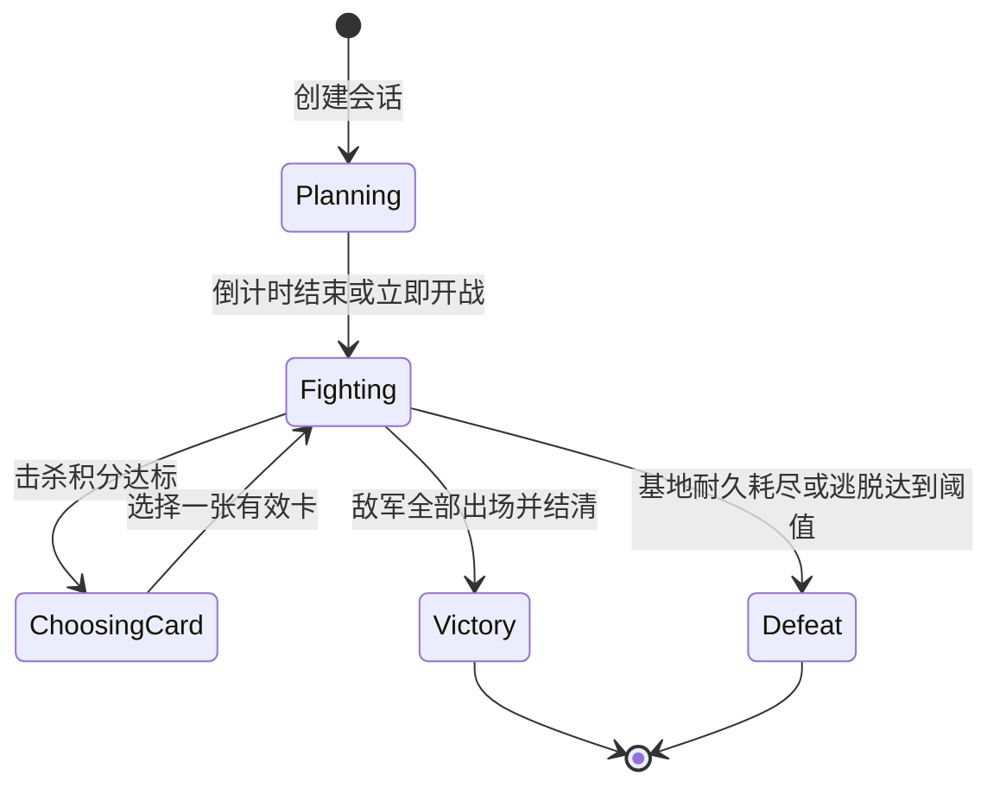

# 玩法循环与数据结构

## 最小战斗循环

出征前的准备页汇总关卡目标、失败条件、敌人和胜负补给。确认后才申请战场美术资源。一局开始后固定关卡配置和随机种子，重试复用该种子。开场有 10 秒备战时间，玩家可以建塔、等待倒计时结束或立即开战。随后敌军按时间连续出兵。敌人按配置路线移动，塔在领域中选目标并结算命中。每击杀一名敌人获得 1 点击杀积分，积分达标时暂停模拟并选一张强化卡，选完继续当前战斗。

每张地图的目标配置位于 [地图规则目录](../../Assets/GameAssets/TowerDefense/Maps)。JSON 文件与 `TdStage.mapAsset` 的文件名对应，`objectiveType` 对应 `BattleObjectiveType`，`targetName` 用于准备页和战场目标标牌。

地图的 `assault` 配置包含增援间隔 `reinforcementGapTicks`、首抽门槛 `firstDraftPoints` 和后续门槛 `repeatDraftPoints`。当前值为 100 tick、6 分和 12 分。增援间隔从上一批最后一个敌人出场到下一批首个敌人出场计算。击杀金币即时发放，各出兵批次的防守金币在该批全部结算后发放。

| 目标类型 | 参数 | 判定 |
| --- | --- | --- |
| `DefendBase` | `baseAttackIntervalTicks`，每 tick 为 50 毫秒 | 敌人停在距基地路线末点 1.2 米的入口，首次到达时攻击，随后按设定间隔攻击。全歼敌军且基地仍有耐久时获胜，基地耐久归零时失败。 |
| `InterceptEscapes` | `escapesToDefeat` | 各路线共用同一传送门末点。到达传送门的敌人离场并计为逃脱，全局计数达到阈值即失败。最后一名敌人离场时，逃脱数低于阈值则获胜。例如峡谷双潭填 7，最多允许 6 名逃脱。 |

守基地关卡的 `baseUpgrades` 从 Lv.1 升 Lv.2 起逐级配置 `goldCost` 和 `durabilityIncrease`。备战和战斗中可点击基地或标牌，用局内金币加固。加固同时提高上限和当前耐久，保留此前受损的点数。修理和回复强化以当局最新上限结算，重开时恢复初始等级和耐久。

战斗表现不决定伤害：当前原型使用即时命中规则，弹道、闪光和受击动画仅表现结果。以后若需要有飞行时间、穿透、爆炸或弹道阻挡，必须把相应规则移入领域模拟，而不是让 Unity 碰撞回调直接改血量。

选卡和玩家暂停都停止模拟 tick，UI 和选卡动画继续更新。BattlePauseState 独立维护手动暂停、应用挂起、失焦与返回确认；解除一个来源不清除其他来源。手机切后台也停止本地模拟；恢复时丢弃积累时间并跳过首个模拟帧，不把后台经过的真实时间补进战斗。是否允许有奖励战斗暂停、暂停多久，由后端策略另行规定。

## 当前领域配置与后续拆表

战斗 schema 是 [towerdefense.xml](../../Config/Luban/Defines/towerdefense.xml)，对应 8 个 Excel 输入和 `cfg.Tables` 下的 `TbTd...` 表；[client.xml](../../Config/Luban/Defines/client.xml) 定义主题、旅程任务、玩家等级以及营地等级/任务 5 张表。加上 Example 共 14 张表。当前关卡为 6 波、7 建造点、3 塔型、4 怪物型、7 张卡；静态 `DemoConfiguration` 仍是测试用的 5 波版本。营地配置与存档规则见[海岛说明](../Game/IslandCamp.zh-CN.md)。

| 已有表 / bean | 主键和关系 | 关键字段 |
| --- | --- | --- |
| `TbTdStage / TdStage` | `id`；关卡根 | `name,configVersion,initialGold,baseHealth,mapAsset` |
| `TbTdRoutePoint / TdRoutePoint` | `id`；`stageId → TdStage`，同关卡内 `routeId+sequence` 排序唯一 | `x,y`，整数毫米坐标；同一路线顺序组合为折线 |
| `TbTdBuildSlot / TdBuildSlot` | `id`；`stageId → TdStage` | `x,y`，固定建造点 |
| `TbTdTower / TdTower` | `id` | `buildCost,upgradeCost,damage,range,attackIntervalTicks,maxLevel,upgradeDamage,upgradeRange` |
| `TbTdEnemy / TdEnemy` | `id` | `health,speedPerTick,goldReward,baseDamage` |
| `TbTdWave / TdWave` | `id`，`stageId → TdStage`，`sequence` 决定出兵顺序 | `rewardGold` 为该批结算金币，`giveCard` 用于旧会话 |
| `TbTdSpawn / TdSpawn` | `id`；`waveId → TdWave`，`enemyId → TdEnemy`，`routeId` 必须属于该波关卡 | `count,startTick,intervalTicks` |
| `TbTdCard / TdCard` | `id` | `name,description,effect,value,weight,maxStacks,iconIndex,rarity` |
| `TbClientTheme / ClientTheme` | `id` | 字体、面板、图标、头像、背景与启动布局地址 |
| `TbJourneyTask / JourneyTask` | `id` | 长期目标指标、目标数量与本地探索经验；正式奖励走服务器 |
| `TbPlayerLevel / PlayerLevel` | `id` | 累计探索经验门槛与称号 |

表中的外键/排序/资源地址还需要在配置适配边界校验；普通 `int` 字段不是写了名字就自动获得 Luban 外键约束。`iconIndex/rarity` 属于表现数据；现有抽牌仍用卡牌单池权重，不因写入 `rarity` 就产生分层稀有度抽取。

`FightConfiguration` 的领域形状如下，供配置适配器与表结构对照；复杂升级曲线等才需要后续增加独立表。

| 原型配置 | 原型字段 | 当前表映射 / 后续扩展 | 关系与校验 |
| --- | --- | --- | --- |
| 会话/关卡 | 初始金币、基地最大生命、路线、建造点、波次 | `TbTdStage`，`id` | 保存关卡初值及按顺序的波次引用；绑定地图表现 ID；初值非负 |
| `RouteDefinition` | `Id`、`Position2[] Points` | `TbTdRoutePoint`，按 `stageId/routeId/sequence` 组合 | 至少两点，禁止相邻重复点；波次的 `RouteId` 必须存在 |
| `BuildSlotDefinition` | `Id`、`Position2 Position` | `TbTdBuildSlot`，`id` | 关卡内唯一；不落在路径或基地碰撞占地中；不能依赖图片识别生成 |
| `TowerDefinition` | `Id/Name`、建造/升级费用、伤害、射程、攻击间隔 tick、最大等级、每级伤害/射程增量 | `TbTdTower`，`id` | 费用非负、间隔大于零；正式升级曲线复杂时拆 `TbTowerLevel(towerId,level)` |
| `EnemyDefinition` | `Id/Name`、生命、每 tick 速度、金币奖励、基地伤害 | `TbTdEnemy`，`id` | 生命和速度大于零，奖励/基地伤害非负；模型及动画由表现表关联 |
| `WaveDefinition` | `Id`、结算金币、`GiveCard`、刷怪组数组 | `TbTdWave`，`id` | 为连续进攻提供按顺序执行的出兵批次 |
| `SpawnGroup` | `EnemyId/RouteId/Count/StartTick/IntervalTicks` | `TbTdSpawn`，按 `waveId` 组合 | 外键指向敌人和关卡路线；数量、间隔和起始 tick 有上限；不得整数溢出 |
| `CardDefinition` | `Id/Name/Description`、效果类型和值、抽取权重、最大叠层 | `TbTdCard`，`id` | 稳定 ID；权重为正；已满层或无效卡不应进入候选集 |
| 表现绑定 | 公共 UI、地图、卡牌图标，当前 3D 由代码生成 | `TbClientTheme` 的公共 UI 地址、`TdStage.mapAsset` 和 `TdCard.iconIndex` | 正式模型/动画地址由对应塔/敌人定义关联；领域只持 ID，不读取资源 |

原型效果集合为 `DamagePercent`、`AttackSpeedPercent`、`RangePercent`、`Gold`、`HealBase`。它们适合先验证选卡与叠加体验，不能据此认定燃烧、冰冻、连锁、召唤或主动技能已实现。

BattleBriefing 为准备页汇总全场敌军名册和数量，并为战场显示各出兵批次的路线。战斗 HUD 显示剩余敌军、增援倒计时和当前抽卡积分。

当前三个塔型全部是单体即时命中，差异在基础伤害、射速、射程和费用；即使名字为炮塔，也尚无范围伤害。百分比卡跨波保留，对全塔生效并按百分点线性累加；金币和修复卡是即时局内效果，没有局外成长写入。

## 正式数据结构建议

当内容开始增长，按下列结构扩充，避免把所有分支写成 `if(cardId == ...)`。这些是职责与 Bean 结构建议，并非要求每项都新开一张表：卡牌效果、抽取池条目、塔等级优先作为所属配置的列表；只有独立复用、独立版本管理的内容才拆表。整体分组以[客户端与数据规划](../Game/ClientPlan.zh-CN.md)为准。

| 表/bean | 关键结构 | 用途 |
| --- | --- | --- |
| `TbAttack` | `id,targetPolicy,damageType,range,intervalTicks,projectileRuleId` | 把最近/最前/最高血量等目标策略与塔数值分开；目标选择稳定地用实例 ID 打破平局 |
| `TbEffect` | `id,trigger,selector,attribute,operation,value,durationTicks,stackRule` | 由白名单枚举表达效果；禁止表内任意脚本字符串和反射执行 |
| `CardEffect` | `cardId,effectId,order` | 一张卡可以关联多个效果，按照确定顺序应用；开始时仍可保留原型的单效果格式 |
| `TbDraftPool` | `id,drawCount,rarityWeights,rerollPolicyId` | 定义关卡/阶段使用的候选池，固定 `drawCount=3` 是当前玩法选择 |
| `DraftPoolEntry` | `poolId,cardId,weight,unlockConditionId` | 关卡定制和解锁条件；`poolId+cardId` 唯一 |
| `TbRarity` | `id,nameKey,colorToken,frameAddress` | 稀有度显示与抽取权重分离；不能只靠颜色区分 |
| `TbReward` | `id,itemId,min,max,limitPolicyId` | 有经济价值的最终奖励由服务器计算；客户端只展示配置预览 |
| `TbUnlock` | `id,requirementType,value` | 后续塔/卡牌/关卡解锁；服务器档案与客户端可用内容一致 |
| `TbLocalization` | `key,language,text` | 图像不烘焙中文；卡名、描述、数值格式和错误提示可本地化 |
| `TbBalanceProfile` | `id,stageId,ruleSetId,modifierSet,configVersion` | 普通/挑战/活动规则明确版本，不在运行中的关卡偷偷换表 |

`Position2` 当前使用整数毫米坐标；表现层将 X/Y 映射到 Unity X/Z，不能直接把屏幕像素写进战斗配置。攻击范围、路线长度和每 tick 速度也用毫米，表现层按每米 1000 毫米换算。时间统一用整数 tick；当前原型一个 tick 为 50 ms。跨平台数值实现仍需测试，固定 tick 和 seed 不自动等于跨所有 CPU/IL2CPP 的位级一致重放。

数值计算要在文档和实现中约定顺序：基础值 → 升级值 → 固定加值 → 百分比加成 → 最终乘区 → 限幅。正式多效果系统上线前必须明确加算/乘算、四舍五入和最小攻击间隔；原型中的效果实现以其领域代码为准，不把未来公式默认为已经实现。

## 三选一卡

1. 只在领域规定的时机创建一次候选集，打开/关闭弹窗或切后台不重新抽卡。
2. 用会话 seed 和明确版本的 PRNG 生成候选；从满足前置条件、未满叠层的条目按权重无放回抽取，保证同屏不重复。
3. 选择命令必须校验当前状态、候选索引/ID 和候选集版本。成功后立即消费候选集；重复点击不叠加两次。
4. 候选不足三张必须有明确规则，避免软锁。建议正式版配置一个无限叠层的金币类兜底池；是否允许少于三张、重抽、跳过或保底稀有度仍需产品决定。
5. 正式稀有度可使用“先按稀有度，再在该稀有度按牌权重抽取”，或者直接单池权重。首版原型是单池权重，不应在表现层再随机改稀有度。

击杀积分达标时进入 ChoosingCard，暂停出兵和战斗时间。选卡后恢复当前战斗，超出门槛的积分计入下一次选择。品级采用白、绿、蓝、紫、橙五档，主题与稀有度、叠层分别配置。具体见[卡牌等级与表现规划](../Game/CardDraft.zh-CN.md)。

建议第一批流派围绕三个容易解释的轴扩展：高频攻击、重击范围、经济续航。先验证每次选择有取舍，再增加元素体系、塔合成与复杂触发链。卡牌效果描述应由结构化数值生成或校验，防止描述和实际效果不符。

## 数据所有权

| 数据 | 保存位置 | 是否可信/可热更 |
| --- | --- | --- |
| 静态战斗定义 | Luban → 热更生成代码及二进制 → YooAsset | 随发行版本绑定；一次战斗锁定版本；客户端表不能决定最终经济奖励 |
| 局内运行状态 | `FightSession` | 只在当前局使用；塔实例、怪物实例、金币、选卡记录和模拟 tick 不回写静态表 |
| 玩家档案 | 服务器；客户端缓存只作显示 | 货币、付费物品、解锁、体力和进度以服务器为准 |
| 本地偏好 | 现有 `GameSettings` / `LocalStorageManager` | 音量、画质、输入绑定和界面偏好；不得当作账号凭证或经济账本 |
| 断点快照 | 版本化局内存档及服务器恢复策略 | 包含 runId、seed、配置版本、命令日志/快照版本；是否可领取奖励需服务器确认 |

Luban 导出阶段应校验重复主键、失效外键、空路线、越界建造点、负费用、零攻击间隔、不可结束波次、抽卡空池和资源地址不存在。客户端加载时仍做结构校验并报告关卡 ID/表 ID；失败时回到可恢复界面，不带着半套配置开始战斗。
